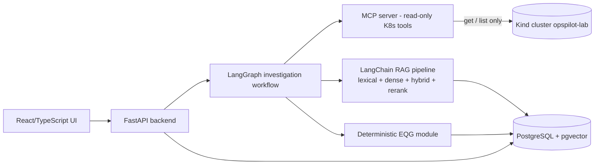

# OpsPilot — Evidence-Quality-Aware Kubernetes Incident Diagnosis

**TEK-UP University — AI Engineering — Bilel Amri & Mohamed Amine Gotai**

OpsPilot is an AI assistant that investigates Kubernetes incidents using **read-only
Kubernetes evidence**, a **RAG** pipeline over versioned official Kubernetes
documentation, **MCP** tool calling, **LangChain/LangGraph** workflow orchestration,
and an LLM.

The main research contribution is a **deterministic Python Evidence Quality Gate
(EQG)**: before the LLM is allowed to formulate a *confirmed* diagnosis, the EQG
checks four properties of the collected observations — **completeness, freshness,
consistency and provenance** — and produces an explicit, reproducible decision
(`SUFFICIENT / PARTIAL / STALE / CONFLICTED / INVALID_PROVENANCE`). The system then
measures whether the EQG **reduces unsupported diagnoses** without **unnecessarily
reducing diagnostic coverage**. No improvement is assumed in advance: the hypotheses
(H1–H5 of the specification) are to be tested, including cases where the gate
blocks valid evidence or lets degraded evidence pass.

This repository follows the authoritative specification
[`Cahier_des_charges_OpsPilot.pdf`](docs/specification/Cahier_des_charges_OpsPilot.pdf)
(V1.3 — French original; features described are *objectives to be implemented and
verified*, not claims of completed work).

---

## The problem

When a Kubernetes incident occurs, an engineer must correlate several observation
types: pod/container states, application logs, Kubernetes events and declarative
configuration. LLM assistants can synthesize these observations with documentation,
but a fluent answer guarantees **none** of the following:

- that an observed log or event belongs to the *right* Pod UID or container instance;
- that the observation is *recent enough* for the incident window;
- that pod phase and container state were not confused (e.g. `CrashLoopBackOff` is a
  container `Waiting` reason, **not** a Pod phase);
- that a cited documentation excerpt actually supports the claimed fact, and that it
  is compatible with the *cluster's Kubernetes version*;
- that conclusions are grounded in the evidence at all.

OpsPilot makes these quality properties **explicit, deterministic and testable**.

## Objectives

1. Build a **reproducible local Kind cluster** laboratory generating controlled
   incidents (SC-01 CrashLoopBackOff, SC-02 ImagePullBackOff, SC-04 OOMKilled).
2. Collect observations **read-only** through four MCP tools
   (`list_pods`, `get_pod_status`, `get_pod_logs`, `get_recent_events`).
3. Normalize every observation into a **traceable evidence schema** (identity,
   provenance, timestamps, snapshot link, payload hash).
4. Implement the **deterministic EQG** with explicit per-scenario rules.
5. Build a **versioned documentation corpus** (official Kubernetes docs, versions
   1.36 and 1.37, CC-BY-4.0) and a RAG pipeline with lexical / dense / hybrid
   retrieval and reranking, plus **citations separated** from operational evidence
   (`D…` for documents, `E…` for observations).
6. Orchestrate one investigated workflow with **LangGraph**, generate a structured
   report, and **validate it deterministically** after generation.
7. Evaluate: RAG benchmark (≥ 50 questions), EQG benchmark (12 degraded
   conditions → extensible 24), and end-to-end diagnostic comparison
   (D1 evidence-only / D2 +RAG / D3 +EQG).
8. Document limits, errors and trade-offs honestly.

## Architecture overview

Modular monolith (single FastAPI backend) + separate MCP server (isolate cluster
permissions) + PostgreSQL (+ pgvector for dense retrieval) + React/TypeScript web UI.
Full rationale: [`docs/architecture/ARCHITECTURE.md`](docs/architecture/ARCHITECTURE.md).



Key principle: **the demo container and the backend are two different things.**
`demo-app/` is a tiny disposable application deployed *inside* Kind only to generate
controlled incidents. The FastAPI backend (created in S5) lives in `backend/`.

## Technologies

| Layer | Technology | Status |
|---|---|---|
| Kubernetes lab | Kind on Docker, kubectl | ✅ configs committed (S0), **cluster creation pending G0** |
| Incident scenarios | SC-01 / SC-02 / SC-04 manifests + demo app | ✅ committed (S0/S1), run validation pending |
| Collect | MCP Python SDK v2 (Python ≥ 3.11) | 📋 planned S2 |
| Evidence + EQG | Pure Python, typed schemas | 📋 planned S3 |
| RAG | LangChain, PostgreSQL FTS, pgvector | 📋 planned S4 |
| Workflow / report | LangGraph + LLM (model TBD after feasibility test) | 📋 planned S5 |
| Frontend | React + TypeScript | 📋 planned S5 |
| Evaluation | pytest, JSON/YAML validation, GitHub Actions CI | 📋 planned (lint/CI wiring in S2, benchmarks S6) |

A dedicated **repository roadmap** (`docs/project/ROADMAP.md`) tracks what is
**planned / implemented / tested** for S0–S7.

## Features (current repository state)

- 📄 Complete documentation set: README, TEAM, CONTRIBUTING, architecture (Mermaid),
  roadmap, S0/S1 plan, team work plan, requirements traceability, spec copy.
- 🧪 **S0**: environment verification script, Kind cluster config, read-only RBAC
  (namespace `opspilot-lab`, ServiceAccount `opspilot-mcp`, explicit `kubectl auth
  can-i` refusals tested in scripts), YAML-validity tests.
- ⚡ **S1**: three incident scenario manifests + a lightweight demo **FastAPI**
  application with three behaviors (healthy, crash-on-start, memory overrun),
  build/load/deploy/reset PowerShell scripts, manual evidence collection script
  (status / logs current+previous / events), basic pytest validation suite.

⚠️ **Environment caveat (honest status):** at the time of the initial commit, the
local Docker Engine was **not running** and **Kind was not installed**, so the
scripts are *implemented but not yet executed against a real cluster*. The GO/NO-GO
gate G0 (spec §17.3/§20.5) is **open**: install/start nothing automatically here —
run `scripts/check-environment.ps1`, start Docker Desktop, install Kind, then run
`scripts/create-cluster.ps1`. Do not treat the lab as working until
`kubectl get pods -n opspilot-lab` shows a real generated incident.

## Quick start (S0/S1, once G0 passes)

Requirements: Windows 10/11, Docker Desktop (Linux engine, WSL2), Kind
(v0.33.0 — see `k8s/kind-config.yaml` for the pinned node image), kubectl
(v1.36–1.38 for the pinned Kubernetes 1.37.0 node; upgrade the client manually —
currently installed 1.34.1 is below the skew window), Python ≥ 3.11 (tested with
3.14), PowerShell.

```powershell
# 0) Check the environment (prints GO/NO-GO per item)
./scripts/check-environment.ps1

# 1) Create the Kind cluster + namespace + read-only RBAC
./scripts/create-cluster.ps1

# 2) Build the demo image and load it into the cluster
./scripts/build-load-demo-image.ps1

# 3) Trigger a scenario and observe the real incident
./scripts/run-scenario.ps1 -Scenario SC-01     # CrashLoopBackOff
./scripts/run-scenario.ps1 -Scenario SC-02     # ImagePullBackOff
./scripts/run-scenario.ps1 -Scenario SC-04     # OOMKilled (exit code 137)

# 4) Collect manually the first real evidence snapshot (status / logs / events)
./scripts/collect-manual-evidence.ps1 -Scenario SC-01

# 5) Reset the scenario (the MVP never mutates the cluster otherwise)
./scripts/reset-scenario.ps1 -Scenario SC-01

# 6) Validate the YAML configuration with the basic static test suite (no cluster needed)
python -m pip install -r requirements-dev.txt   # first time: pytest + PyYAML
python -m pytest tests/ -v
```

## Repository structure

```
OpsPilot/
├── README.md, TEAM.md, CONTRIBUTING.md, .gitignore, .env.example, requirements-dev.txt
├── docs/
│   ├── architecture/ARCHITECTURE.md       # full architecture + Mermaid diagram
│   ├── project/                           # ROADMAP, S0_S1_PLAN, TEAM_WORK_PLAN,
│   │                                      # REQUIREMENTS_TRACEABILITY
│   └── specification/                     # canonical specification copy (+ readable extraction)
├── k8s/kind-config.yaml                   # Kind cluster definition
├── k8s/rbac/                              # namespace, ServiceAccount, Role, RoleBinding
├── scenarios/             # SC-01, SC-02, SC-04 manifests + scenario contracts
├── demo-app/              # lightweight incident-generator application (not the backend!)
├── scripts/               # PowerShell: check-environment, create/create-cluster,
│                          # build/load image, run/reset scenario, collect evidence
└── tests/                 # basic validations (YAML, RBAC read-only, scenario contracts)
```

## License note

The OpsPilot repository is coursework. The future RAG corpus will re-use official
Kubernetes documentation under **CC-BY-4.0** with full attribution (URL, version,
date, license text in a corpus manifest) — see spec §8.1 and the **Attribution**
section in CONTRIBUTING.

## Roadmap (summary — details in `docs/project/ROADMAP.md`)

| Stage | Objective | Status |
|---|---|---|
| S0 | Environment validation, literature matrix, GO/NO-GO | 🔄 configs committed, G0 pending |
| S1 | Kind lab + FastAPI demo app + the three mandatory scenarios (SC-01, SC-02, SC-04), real first snapshot | 🔄 implemented, awaiting cluster |
| S2 | 4 MCP tools + RBAC tests (+ **optional** SC-03 Pending Pod extension only if MVP-stable) | 📋 planned |
| S3 | Evidence schema + EQG | 📋 planned |
| S4 | RAG pipeline + corpus 1.36/1.37 | 📋 planned |
| S5 | LangGraph workflow + LLM report validator + base UI | 📋 planned |
| S6 | Benchmarks (RAG ≥ 50 q, EQG 12→24 cases, D1/D2/D3) | 📋 planned |
| S7 | Finalization, report, demo, defence | 📋 planned |
