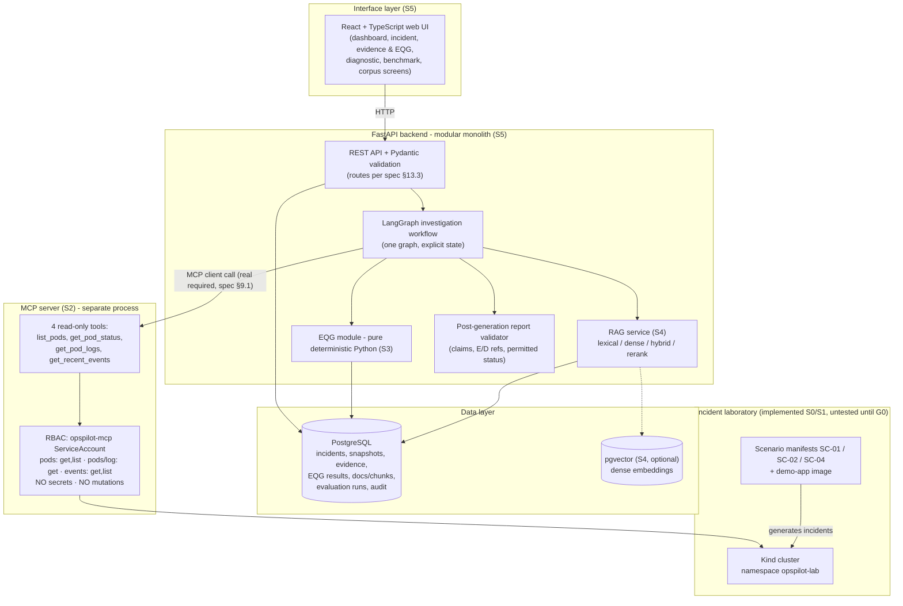
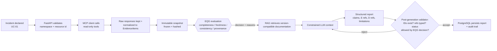

# OpsPilot Architecture

Source of truth: `Cahier_des_charges_OpsPilot.pdf` V1.3 (spec §7–§11, §14).
This page explains the architecture in the repository's own words for day-to-day work.

## 1. Design principles

1. **Modular monolith, not microservices** (spec §4.2, §7.2): one FastAPI backend
   contains the API, workflow coordination, RAG access and EQG service. One
   deliberate exception to the single process: the **MCP server is a separate
   component** so the Kubernetes-facing permissions live in exactly one place.
2. **EQG is a deterministic Python module**, independent of any LLM provider
   (spec §7.2). No network, no randomness, no model behind the gate. Votes on the
   quality of evidence come from typed rules, not from the model.
3. **Read-only Kubernetes access, forever** (spec §15.3): OpsPilot never creates,
   updates, patches, deletes, restarts or scales anything. RBAC + tools + tests all
   enforce this. The *only* allowed cluster mutations are the scenario scripts that
   deploy the deliberately-broken demo workloads (a human explicitly runs them and
   the scripts are documented lab actions, not system behavior).
4. **Determinism where decisions are made, honesty everywhere**: snapshots are
   immutable, evidence fields unknown stay `null`/`unknown` (never fabricated), and
   any collection error is surfaced, never silently converted into neutral data
   (NFR-01).
5. **Separate citation domains**: operational observations are referenced `E…`,
   documentation passages `D…` (spec §8.6). Documentation `D` explains a mechanism
   but **never proves** that something happened in the cluster.

## 2. Logical architecture

## 3. Investigation data flow (spec §7.3, §11.1)

The EQG decision (spec §10.5) gates what generation may state:

| Decision | Meaning | Allowed diagnosis strength |
|---|---|---|
| `SUFFICIENT` | critical fields present, provenance valid, identity/time coherent | confirmed (subject to validator) |
| `PARTIAL` | non-critical info missing | tentative hypotheses with explicit limits |
| `STALE` | critical evidence not attachable to incident window/instance | no confirmed diagnosis; recommend recollection |
| `CONFLICTED` | critical observations incompatible for same identity/window | abstain on the conflicting cause, expose conflict |
| `INVALID_PROVENANCE` | required source/identity/hash/collection missing or invalid | evidence rejected; confirmed diagnosis blocked |

Dimensions are kept as **independent flags** — a snapshot can be simultaneously
`PARTIAL` and `STALE`; the aggregate decision follows a documented priority
policy (spec §10.5). Freshness thresholds are per-source/per-scenario, never a
universal TTL (spec §10.5, R-05).

## 4. Layer responsibilities & technology (spec §7.1)

| Layer | Responsibility | Technology |
|---|---|---|
| Interface | declare incident; view evidence, EQG, report, metrics | React + TypeScript (S5) |
| API | request validation, access control, orchestration, persistence | FastAPI + Pydantic (S5) |
| Collect | access Kubernetes resources, return structured evidence | MCP Python SDK v2, k8s API (S2) |
| EQG | evaluate observation properties with deterministic rules | pure Python, typed schemas (S3) |
| RAG | ingestion, metadata, retrieval, reranking, citations | LangChain, PostgreSQL FTS, pgvector (S4) |
| Workflow | steps, errors, state, EQG-driven branching | LangGraph (S5) |
| Data | persist incidents, snapshots, docs, runs, audits | PostgreSQL, pgvector optional (S4/S5) |
| Quality | tests, CI, evaluation reports | pytest, GitHub Actions, MLflow optional (S2/S6) |

## 5. Component-by-repository mapping

| Repository path | Component | Stage | Status |
|---|---|---|---|
| `k8s/kind-config.yaml` | Kind cluster definition (node version pinned policy) | S0 | implemented, **untested until G0** |
| `k8s/rbac/*` | namespace `opspilot-lab`, ServiceAccount `opspilot-mcp`, Role, RoleBinding | S0 | implemented, apply untested |
| `scenarios/*` | SC-01 CrashLoopBackOff, SC-02 ImagePullBackOff, SC-04 OOMKilled manifests + scenario contracts | S0/S1 | implemented, generation untested until G1 |
| `demo-app/*` | small **FastAPI** app whose three behaviors generate the incidents (this is *not* the backend) | S1 | implemented, image build untested until Docker runs |
| `scripts/*.ps1` | environment check, cluster create, image build/load, scenario run/reset, manual evidence collect | S0/S1 | implemented, executions pending |
| `backend/` | FastAPI modular monolith (API + EQG service + RAG + workflow) | S5 | **not created yet** — kept from the repo until S5 to avoid placeholder modules |
| `mcp_server/` | MCP read-only server | S2 | not created yet |
| `evaluation/` | RAG / EQG / end-to-end benchmark runners | S6 | not created yet |
| `tests/` | basic validations now; unit/integration/security suites per stage | S0+ | basic suite **runs** (no cluster needed) |

## 6. MCP server design (S2, spec §9)

- Four tools exactly: `list_pods`, `get_pod_status`, `get_pod_logs`, `get_recent_events`
  (spec §9.2 table = the tool contract).
- Output contracts **distinguish Pod phase from container states** (spec §9.3):
  `CrashLoopBackOff` is a container `Waiting.reason`, not a Pod phase.
- Parameter bounds: allowed namespace, `tail_lines` bounded, event `limit` bounded,
  `previous` flag for logs (spec §9.2, SEC-05: schema validation on every tool input).
- MCP Python SDK **v2 stable** line, Python ≥ 3.11, version frozen in dependencies
  once chosen; no mixing of v1 examples (spec §9.5).
- A *real* MCP call from the workflow is required to satisfy the course requirement —
  the existence of a schema file is not sufficient (spec §9.1).

## 7. RAG pipeline design (S4, spec §8)

- Corpus: official Kubernetes documentation, versions **1.36 and 1.37**, 30–50 pages
  per version → ~60–100 pages before deduplication, frozen in a **corpus manifest**
  (URL, version, collection date, content hash, CC-BY-4.0 attribution).
- Ingestion per spec §8.3: discovery → collection → normalization → segmentation
  (title/anchors kept) → metadata (§8.4 fields) → deduplication → indexing → update.
- Retrieval configurations compared in S6: **R1** lexical PostgreSQL
  (`tsvector`/`ts_rank[_cd]` — never called "BM25"), **R2** dense via pgvector,
  **R3** hybrid (documented fusion, e.g. RRF), **R4** hybrid + cross-encoder rerank.
- `k8s_version` is mandatory metadata; `unknown` is forbidden for strict filtering.
  Unknown cluster version ⇒ no implicit filter, ask or limit (spec §13.4 of
  error-handling expectations, §11.4).

## 8. Security architecture (spec §6.3)

| Control | Mechanism |
|---|---|
| SEC-01/SC limits | dedicated ServiceAccount `opspilot-mcp` in lab namespace only |
| SEC-02 verbs allowed | `pods get/list`, `pods/log get`, `events get/list` only; refusal verified per verb via `kubectl auth can-i` (`tests/test_rbac_manifests.py` + script step) |
| SEC-03 secrets | Role explicitly excludes `secrets`; no code path reads secrets |
| SEC-04 data hygiene | logs/docs treated as untrusted data, never instructions; deterministic policy layer |
| SEC-05 input guards | schema validation, bounds, allowed namespace, timeouts on tool inputs |
| SEC-06 output guards | post-generation validator: E/D ids exist, type-correct refs, status allowed by EQG decision |
| SEC-07 keys | `.env` only (git-ignored), `.env.example` documented |
| SEC-08 no remediation | no write verbs in RBAC, no write code, no write tools |

## 9. Data model summary (spec §14)

Main entities: `User`, `Incident`, `EvidenceSnapshot`, `EvidenceItem`, `EQGResult`,
`Document`, `DocumentChunk`, `Investigation`, `DiagnosisClaim`,
`EvaluationQuestion`, `EvaluationRun`, `EvaluationCase`. Persistence principles:
original snapshots immutable; degraded variants reference a parent snapshot and
describe the transformation (spec §14.2); EQG results versioned by rule version;
every investigation records model, prompt version, parameters, corpus and snapshot.
Indexing (spec §14.3): incident_id, snapshot_id, namespace, pod_uid, source_type,
collected_at, doc version, document_id, evaluation split; pgvector index created
only after the embedding model is selected.

## 10. Known architectural trade-offs

- Kind + local services co-hosting costs RAM: if constrained, services run
  **sequentially** (spec §20.5 fallback) — the fast path is lab scripts, then
  backend+PG on demand.
- MCP as a separate process adds IPC complexity but isolates K8s permissions —
  deliberate, spec-required (§7.2).
- PostgreSQL FTS is not BM25 and must not be labeled BM25 in any report (spec §12.1).
- A small monolith-for-two-students trades horizontal scalability for
  reviewability — acceptable per spec §4.2.
